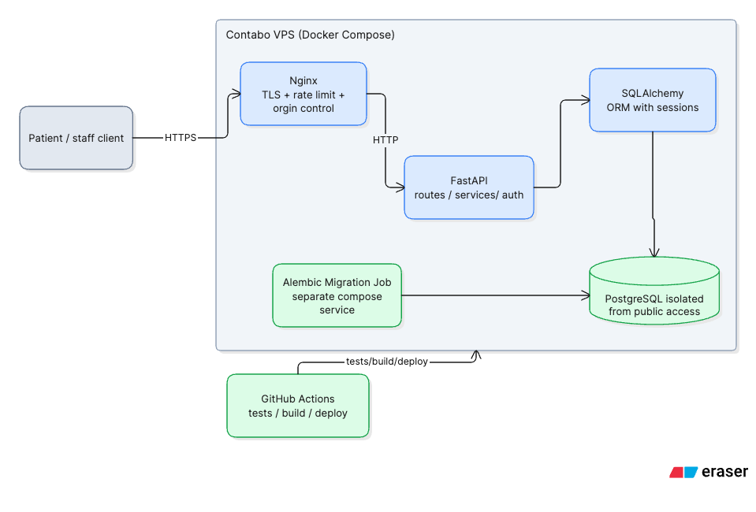
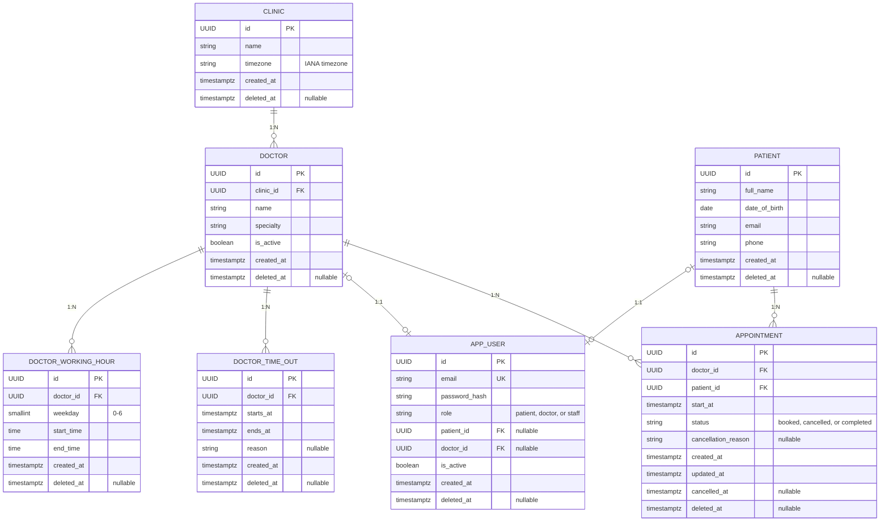

# Clinic Appointment Booking API

**Stack:** Python, FastAPI, PostgreSQL, Docker Compose, Contabo VPS, Nginx, GitHub Actions.  
**Public URL:** Add the live application URL.

A REST API for a 5-doctor clinic. Patients can check availability and book, cancel, or reschedule 30-minute appointments. Doctors can set their working hours, book time off and mark appointments as complete.

## Section 1 — System design

### Components



- **Nginx:** HTTPS, per-IP rate limiting, origin control, and forwarding of trusted proxy metadata.
- **FastAPI routes:** Validate requests, authenticate JWTs, enforce patient and staff permissions, and return HTTP responses.
- **Booking services:**  Calculate each doctor’s open slots and validate bookings and reschedules against working hours, time-outs, existing appointments, and the applicable time limits.
- **SQLAlchemy:** Maps models, runs queries and manages transactions between the application and PostgreSQL.
- **Alembic:** Applies versioned database migrations. After merge, deployment migrates production before starting the new API version.
- **PostgreSQL:** Stores application data. FKs and a partial unique index protect booking integrity.
- **GitHub Actions:** Tests pull requests and deploys passing merges to `main`.

### Data model

All records use UUID primary keys.



**Constraints and indexes**

The database and API enforce these rules:

| Rule | What it means |
|---|---|
| **Valid references** | Foreign keys ensure each doctor, schedule, time-out, and appointment references existing records. |
| **Account links match roles** | A patient account links to its patient record through `APP_USER.patient_id`. A doctor account links to its doctor record through `APP_USER.doctor_id`. Staff accounts have neither link. |
| **Keep history** | Use `deleted_at` to soft-delete records. Set `is_active` to false to deactivate doctor or user accounts. |
| **Valid schedules and states** | Each schedule must end after it starts. A doctor's schedules for the same day cannot overlap. Back-to-back schedules are allowed. Reject schedule changes that conflict with booked appointments until those appointments are rescheduled. Appointment status is `booked`, `cancelled`, or `completed`. |
| **One active booking per slot** | A partial unique index on `(doctor_id, start_at)` for booked appointments prevents duplicate bookings; conflicts return `409 Conflict`. |
| **Cancelled slots can be reused** | Cancelled appointments remain as history and no longer reserve the slot. |
| **Efficient queries** | Index schedules and time-outs by doctor and date, and appointments by doctor or patient and time. |

### Time and booking rules

- The clinic's IANA timezone (for example, `Africa/Nairobi`) interprets local schedules and dates. Store appointment times as UTC instants and return them in UTC.
- Booking and rescheduling require timezone-aware ISO 8601 timestamps. Availability dates use the clinic's local timezone.
- Offer 30-minute slots starting at `:00` or `:30` within working hours. Exclude slots that overlap a booking or doctor time-out.
- A new appointment must be more than 1 hour in the future. Availability omits slots that fail the same rule.
- Patients cannot cancel online during the 2 hours before an appointment. They must call the clinic, where office staff can help.
- Rescheduling is blocked within 1 hour of the existing appointment. The replacement slot must be 1 than one hour in the future and pass all availability checks. A failed reschedule leaves the original booking unchanged.
- Cancellation requires a reason, retains the record, and releases the slot. Repeated cancellation and rescheduling a cancelled appointment are rejected.

**Concurrency**

2 or more patients may book an available slot concurrently, so the API checks it again when booking. SQLAlchemy runs the insert in a PostgreSQL transaction. A partial unique index on `(doctor_id, start_at)` for active appointments ensures only one of two simultaneous requests succeeds. The other receives `409 Conflict`.

Cancellation and rescheduling lock and re-read the appointment row in a transaction. Rescheduling updates the existing appointment. If the new slot is invalid or booked, the transaction rolls back and the original appointment remains booked. The unique index works because appointments last 30 minutes and start on the `:00` or `:30` grid. 

**Trade-off:** Dynamic slot generation avoids storing future slots. One API and database keep the system simple. Scale out if usage requires it.

## Section 2 — API

API routes use the `/v1` prefix. Patients, doctors, and staff authenticate with bearer JWTs in the `Authorization` header. Patients can access only their own appointments, and doctors can access only their own doctor records and appointments. Staff can manage clinic records and appointments. The API scopes queries using the identity in the token rather than caller-supplied patient or doctor IDs.

| Method and path | Access | Purpose |
|---|---|---|
| `POST /v1/auth/token` | Public | Authenticate credentials and return a signed, expiring JWT. Supporting endpoint for the required API. |
| `GET /v1/doctors/{id}/availability?date=YYYY-MM-DD` | Public | Return available 30-minute slots in the clinic timezone, excluding active bookings, time-outs, and slots within the booking notice. |
| `POST /v1/appointments` | Patient or staff | Book a slot. Patients provide `doctor_id` and offset-bearing `start_at`; the API gets their patient ID from the authenticated account. Staff also provide `patient_id` for the patient they are booking for. |
| `PATCH /v1/appointments/{id}/cancel` | Owner or staff | Cancel with a non-empty `reason`. Within two hours, direct the patient to call the clinic. |
| `PATCH /v1/appointments/{id}/reschedule` | Owner or staff | Move an active appointment using offset-bearing `start_at`. Block rescheduling within one hour of the existing start. |
| `GET /v1/patients/{id}/appointments` | Owner or staff | Return active upcoming appointments sorted by `start_at`. Patients can request only their own appointments. |

Patient booking body:

```json
{
  "doctor_id": "doctor-id",
  "start_at": "2026-10-22T10:00:00+03:00"
}
```

Staff booking body:

```json
{
  "doctor_id": "doctor-id",
  "patient_id": "patient-id",
  "start_at": "2026-10-22T10:00:00+03:00"
}
```

Example availability response:

```json
{
  "doctor_id": "doctor-id",
  "date": "2026-10-22",
  "available_slots": [
    {
      "start_at": "2026-10-22T07:00:00Z",
      "ends_at": "2026-10-22T07:30:00Z"
    }
  ]
}
```

**HTTP responses**

- `201`: Appointment booked.
- `200`: Read or update succeeded.
- `401`: Token is missing or invalid.
- `403`: User does not have permission.
- `404`: Resource does not exist.
- `409`: Slot is taken, or appointment state or cutoff prevents the action.
- `422`: Invalid input, time, working hours, or doctor time-out conflict.
- `429`: Nginx rate limit reached.


## Security and privacy

- **Authentication and authorization:** JWT bearer tokens identify patient, doctor, or staff accounts. Check ownership and role on every protected route. Patient and doctor IDs alone are not identity. Store password hashes.
- **Patient data:** Store only the agreed booking details: name, date of birth, email, and phone. Location/address and clinical notes are not needed for this single-clinic booking workflow.
- **Encryption:** HTTPS protects data in transit. Encrypt off-site database backups.
- **Database and host:** Use SQLAlchemy parameterized queries and transactions. Keep PostgreSQL private, secure SSH, and run containers with minimal privileges.
- **Nginx rate limiting:** Nginx limits each client IP to 100 requests per minute, allows a configured brief burst, and returns 429 when the limit is exceeded. It trusts forwarded IP addresses only from configured proxies to prevent clients from spoofing their IP.
- **Errors, logs, and recovery:** Return safe errors, avoid logging patient details. No back up fro this demo.

## Section 3 — Deployment and CI/CD

### Contabo deployment

Docker Compose runs Nginx, FastAPI, Alembic migration worker and PostgreSQL. Only Nginx's 443 web port and ssh 22 are public. PostgreSQL and the API remain on private networks. Nginx handles HTTPS. A persistent database volume supports recovery from container replacement but not a full back up.

### CI/CD

GitHub Actions tests pull requests targeting `main`. After a passing pull request is merged, the release workflow creates a unique version tag, builds and deploys the image for that commit, then runs Alembic migrations before starting the new API version. Deployment secrets stay in GitHub Actions. The workflow verifies application health and fails if tests, migrations, or deployment fail. The `main` branch requires passing PR checks.

## Run and test

Start the application with Docker Compose. Alembic manages schema changes, and the test suite runs against PostgreSQL. FastAPI's interactive documentation is available at `/docs`.

The test suite covers JWT authentication and patient/staff authorization, booking validation and concurrent conflicts, availability and DoctorTimeOut exclusion, cancellation and slot reuse, the two-hour cancellation restriction, the one-hour reschedule restriction, failed-reschedule preservation, and upcoming appointment ordering against PostgreSQL.

### Optional demo data

From `backend/`, apply the migrations, configure the local database, set `DEMO_SEED_PASSWORD` to a local-only value of at least 12 characters, and run `uv run python scripts/seed_demo.py`. The seed is explicit, not run at application startup or during deployment. It creates one clinic, five doctors with weekday hours, 40 fictional patients, one staff account, and sample appointment history. Stable IDs make reruns safe: existing records are left unchanged, and an email already attached to a different account stops the seed with an error.

Demo logins are `patient01@example.test` through `patient40@example.test`, `doctor01@example.test` through `doctor05@example.test`, and `staff@example.test`. They share the supplied demo password; each account gets its own Argon2 password hash. These fictional accounts and the shared password are for local/demo use only, never production.

## Section 4 — AI reflection

Complete these answers with honest examples from this assessment:

1. **AI use:** AI helped review requirements, compare design choices, refine the architecture and concurrency explanation, and edit this README. Add any further uses from implementation, testing, and deployment.
2. **Helpful suggestion:** Give a real prompt, the suggestion, and how it improved the result.
3. **Wrong or incomplete output:** Give a real example and explain how you caught and corrected it.
4. **Independent decisions:** Name two decisions you made yourself and why you trusted your judgment.

Review and test AI-generated suggestions before accepting them; do not present placeholders as personal experience.
